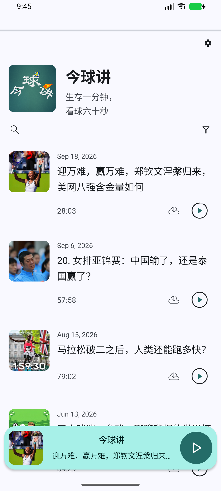
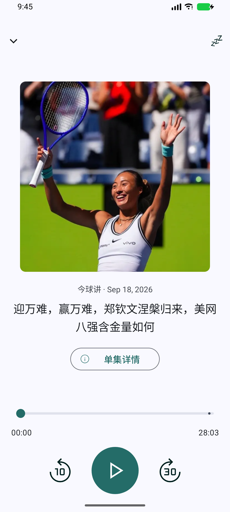
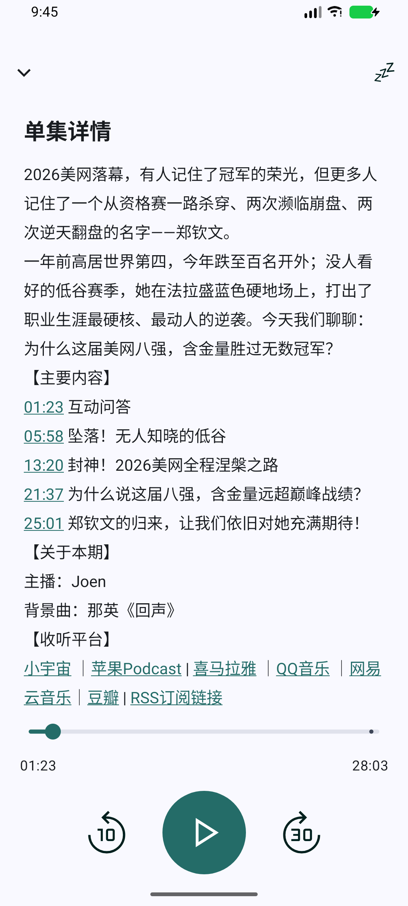
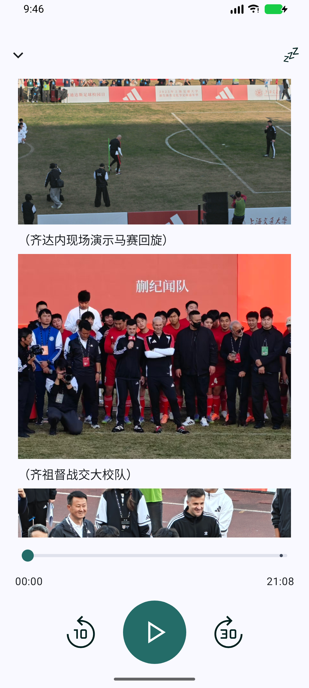

# 今球讲 Android

《今球讲》专属安卓播客播放器，基于 Escapepod 开源项目开发。支持在线播放、离线下载、后台收听，以及带配图和时间戳跳转的单集详情。

当前版本 **1.0.0**，节目源为 [今球讲 RSS](https://feed.xyzfm.space/jkr43da47kq7)。

安卓apk下载：https://github.com/Zidane-Han/JinQiuJiangFM/releases/tag/v1.0.0

## 应用效果

以下为 1.0.0 正式 APK 在 Android API 37 模拟器上的实际截图。节目来自公开 RSS，列表随节目更新。

<table>
  <tr><th>节目首页</th><th>全屏播放器</th></tr>
  <tr>
    <td></td>
    <td></td>
  </tr>
  <tr><th>时间戳跳转</th><th>图文单集详情</th></tr>
  <tr>
    <td></td>
    <td></td>
  </tr>
</table>

- **节目更新**：首页自动同步，支持下拉刷新和约四小时的后台刷新，实际后台执行时间由系统调度。新节目发布到 RSS 后即可获取。
- **播放与下载**：点击单集进入播放页并自动播放，优先使用已下载音频。支持断点续播、快进快退、下一集、睡眠定时及通知栏和耳机控制，播放速度为 1 倍速。
- **单集详情**：上推封面或点击“单集详情”阅读正文。支持小宇宙 CDN 配图和章节时间戳。音频已载入时，点击时间戳保留当前播放或暂停状态。
- **离线与主题**：缓存的节目列表、正文和下载音频可离线使用。配图首次需要联网，之后可读取图片缓存。默认手动下载、仅 Wi-Fi 下载、关闭自动清理。支持浅色与深色主题。

## 环境与版本要求

| 项目 | 当前要求或配置 |
| --- | --- |
| 运行设备 | Android 7.1 及以上，最低 API 25 |
| Android SDK | 安装 Android SDK Platform 37，`compileSdk` 和 `targetSdk` 均为 37 |
| JDK | Gradle daemon 使用 JDK 21，由 `gradle/gradle-daemon-jvm.properties` 指定 |
| Java 源码兼容级别 | Java 17 |
| Gradle | 9.6.1，使用仓库自带的 Gradle Wrapper |
| Android Gradle Plugin | 9.5.0 |
| KSP | 2.3.12 |
| 开发工具 | Android Studio 或命令行，安装所需 SDK 和 Platform-Tools |

首次构建需要联网下载 Gradle、JDK 工具链及依赖。Android Studio 需能够同步项目当前使用的 Android Gradle Plugin。

应用版本、SDK 和签名配置在 `app/build.gradle.kts`，插件及主要依赖版本在 `gradle/libs.versions.toml`。

## 构建

### 1. 准备环境

在 Android Studio 中打开仓库根目录，通过 SDK Manager 安装 Android SDK Platform 37 和 Android SDK Platform-Tools，然后等待 Gradle 同步完成。

命令行构建也可以在根目录创建 `local.properties`，填写本机 SDK 路径。以下 macOS 路径需替换为实际用户名。

```properties
sdk.dir=/Users/你的用户名/Library/Android/sdk
```

macOS 已安装 JDK 21 时，可以通过以下命令选择 Java 环境并检查 Gradle 版本。

```bash
export JAVA_HOME="$(/usr/libexec/java_home -v 21)"
./gradlew --version
```

本项目也已使用 Android Studio 自带的 Java 环境成功构建，macOS 可采用以下启动方式。Gradle daemon 仍按仓库配置选择 JDK 21。

```bash
export JAVA_HOME="/Applications/Android Studio.app/Contents/jbr/Contents/Home"
./gradlew --version
```

以下命令均在仓库根目录执行。Windows 对应使用 `gradlew.bat`。

### 2. 构建 Debug APK

```bash
./gradlew assembleDebug --no-configuration-cache
```

生成的 APK 位于 `app/build/outputs/apk/debug/app-debug.apk`，可用于本地开发和调试。

### 3. 运行测试和静态检查

```bash
./gradlew testDebugUnitTest lintDebug --no-configuration-cache
```

当前版本共 16 项测试，覆盖 RSS 解析、播放来源、图标裁切、单集配图与时间戳、返回操作，以及旧数据库和后台任务的升级兼容。报告输出在以下位置。

```text
app/build/reports/tests/testDebugUnitTest/index.html
app/build/reports/lint-results-debug.html
```

### 4. 构建签名 Release APK

发布构建读取本地 `.signing/` 目录中的签名材料。维护现有应用时，应从安全备份恢复原有文件。

```text
.signing/
├── release.jks   # 发布密钥库，别名为 jinqiujiang
└── password      # 密码文本，构建脚本用于读取密钥库和私钥密码
```

签名材料准备好后，执行以下命令。

```bash
./gradlew assembleRelease --no-configuration-cache
```

签名 APK 输出为 `app/build/outputs/apk/release/app-release.apk`。缺少签名材料时会生成未签名的 Release APK，需要完成签名才能安装分发。

当前整理后的发布文件名为 `app/release/JinQiuJiangFM-1.0.0.apk`。该目录属于本地交付目录，已被 Git 忽略，Gradle 不会自动将构建结果复制到这里。

覆盖升级需要沿用 `com.jinqiujiang.fm` 和原发布签名，并递增 `versionCode`。Debug 使用调试签名，无法直接覆盖已安装的正式签名版本。签名材料和 `local.properties` 已加入 `.gitignore`，请单独安全备份密钥。

### 5. 安装到手机

在手机开发者选项中启用 USB 调试，连接电脑并允许调试授权。确保 `adb` 在 PATH 中，或使用 SDK 中 `platform-tools/adb` 的完整路径。

```bash
adb devices -l
adb -s 手机序列号 install -r app/build/outputs/apk/release/app-release.apk
adb -s 手机序列号 shell am start -n com.jinqiujiang.fm/.MainActivity
```

如果手机弹出系统安装确认，请在手机上完成确认。检查安装版本可执行以下命令，并查看输出中的 `versionName` 和 `versionCode`。

```bash
adb -s 手机序列号 shell dumpsys package com.jinqiujiang.fm
```

## 源码位置

| 路径 | 用途 |
| --- | --- |
| `app/src/main/java/com/jinqiujiang/fm/` | 播放器、页面、RSS 同步及数据库等源码 |
| `app/src/main/res/` | 页面布局、图标、主题和多语言文案 |
| `app/schemas/` | Room 各版本数据库结构，供迁移使用 |

RSS、节目名称和稳定标识集中在 `PodcastConfig.kt`。数据库保留历史结构，后台刷新兼容旧源码包名创建的任务。测试 RSS 中的 21 期仅作为固定回归样本，应用节目数量随线上 RSS 更新。

## 开源许可

本项目基于 [Escapepod](https://codeberg.org/y20k/escapepod)，保留上游版权声明及 MIT 许可。
